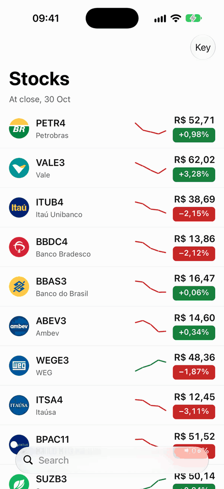

# Stocks

An iOS and Android app for browsing B3 stocks, built with Expo and React Native. Each person connects their own [InvestingData](https://www.investingdata.com.br) API key, then browses and searches stocks and opens one to see its last close, chart and key stats. The look and interactions follow Apple Stocks.

<p align="center">
  
</p>

## Features

- **Stock list:** 15 blue-chip starter tickers sorted by last-session volume, each with its logo, a sparkline of the last 5 closes and a change pill. Tap a pill to cycle every row through % change, R$ change and approximate market cap.
- **Search:** ticker prefix or company name, case- and accent-insensitive, run on the device over the cached company index.
- **Stock details:** last close and change, a scrubbable chart over 1W, 1M, 3M, 6M, YTD, 1Y, 5Y and ALL, key stats and an About section.
- **Your own API key:** checked against InvestingData before it's saved, and stored only in the device keychain. It's never logged, cached or shown beyond its first 8 characters.
- **Within the plan's limits:** requests go through a queue sized to the key's per-minute limit, and price histories are cached on the device, so relaunching the same day doesn't fetch them again.
- Light and dark mode, VoiceOver and TalkBack labels, and Brazilian or English number formatting.

## Getting started

You need:

- an InvestingData API key, from the [InvestingData dashboard](https://www.investingdata.com.br/dashboard);
- Node.js and npm;
- Xcode with an iOS simulator, or the Android SDK with an emulator or device.

```sh
npm install        # also applies the patches in patches/
npm run ios        # builds the development build and installs it on a simulator
```

The app asks for your API key on first launch.

The app is an Expo development build, not Expo Go, because `react-native-mmkv` is a native module. Rebuild with `npm run ios` or `npm run android` after adding or upgrading a native dependency. Day to day, run `npm start` and open the installed build: JavaScript changes reload without a native rebuild.

## Commands

| Command | What it does |
|---|---|
| `npm start` | Starts Metro for an installed development build. |
| `npm run ios` | Generates `ios/`, builds the development build and installs it on a simulator. |
| `npm run android` | The same for Android. |
| `npm run typecheck` | `tsc --noEmit`, in strict mode. |
| `npm run lint` | `expo lint` (ESLint with `eslint-config-expo`). |
| `npm test` | Jest with React Native Testing Library, with MSW mocking the API. |

The quality gate is `npm run typecheck && npm run lint && npm test`. Run it before every commit.

`ios/` and `android/` are generated and gitignored. Never edit them by hand; delete them to regenerate.

## Stack

- Expo SDK 58 and React Native 0.88, in strict TypeScript
- Expo Router on a native stack
- TanStack Query, persisted to MMKV; the API key in expo-secure-store
- A typed fetch client that validates responses with zod
- FlashList for lists, and victory-native (Skia) for charts
- Jest, React Native Testing Library and MSW for tests

## Project layout

- `src/app/`: Expo Router routes (list, API key, stock details).
- `src/features/stocks/`: the API client and queue, caching, derived metrics, hooks and components.
- `src/shared/`: formatting and theme.
- `openspec/specs/`: the behaviour specs for each capability, and `openspec/changes/archive/` for past changes.
- `docs/process.md`: how the team builds and ships.

## Limits

- **End-of-day data only.** There's no intraday chart and no timed polling.
- **The current API data is sparse.** Price bars carry only the close, and company records have no share count, so the stats the app can't derive (open, high, low, volume, market cap) are hidden.
- **Android and TalkBack aren't verified yet.** The app has been checked on the iOS simulator only.
- Not in v1: watchlist editing, news, price alerts, accounts, portfolio tracking, comparing stocks, and widgets.
